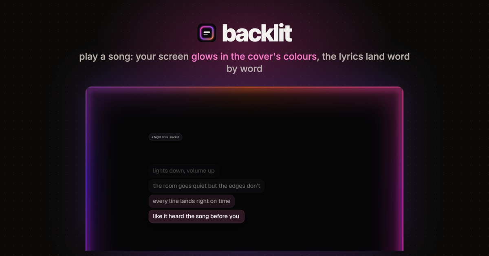
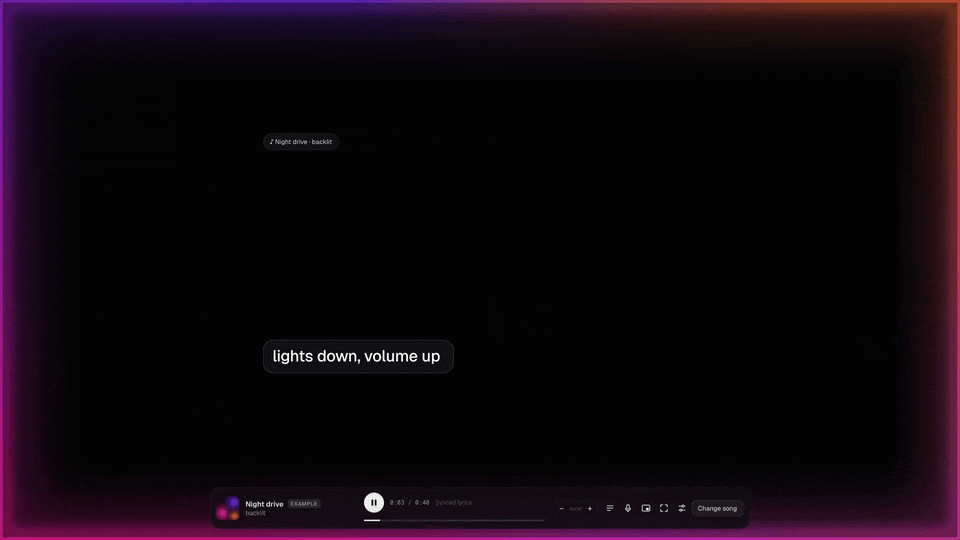
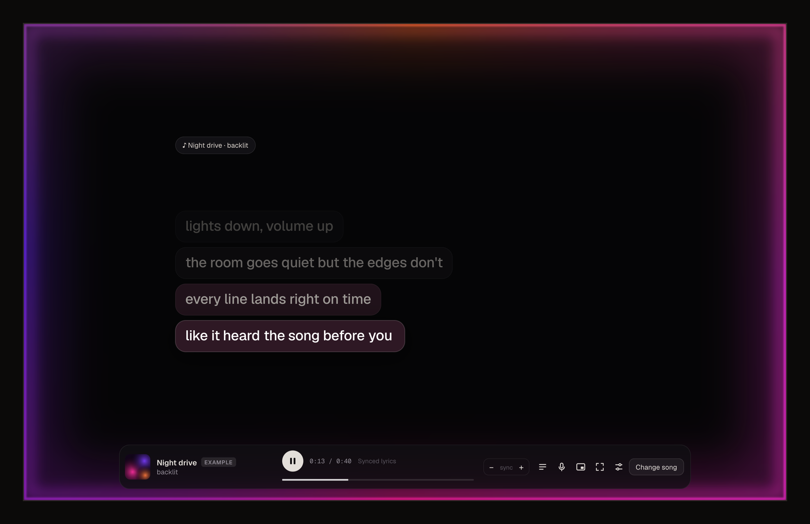
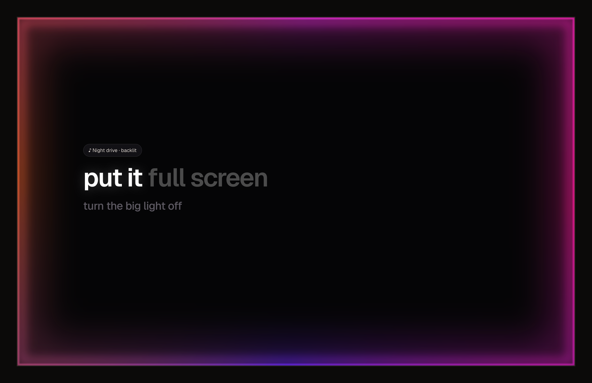
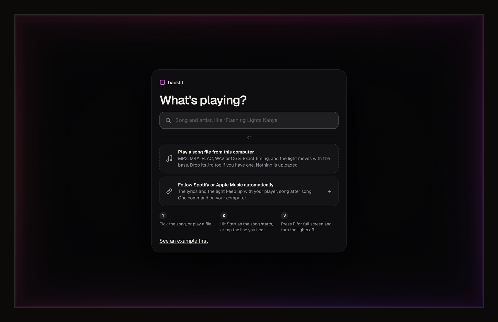
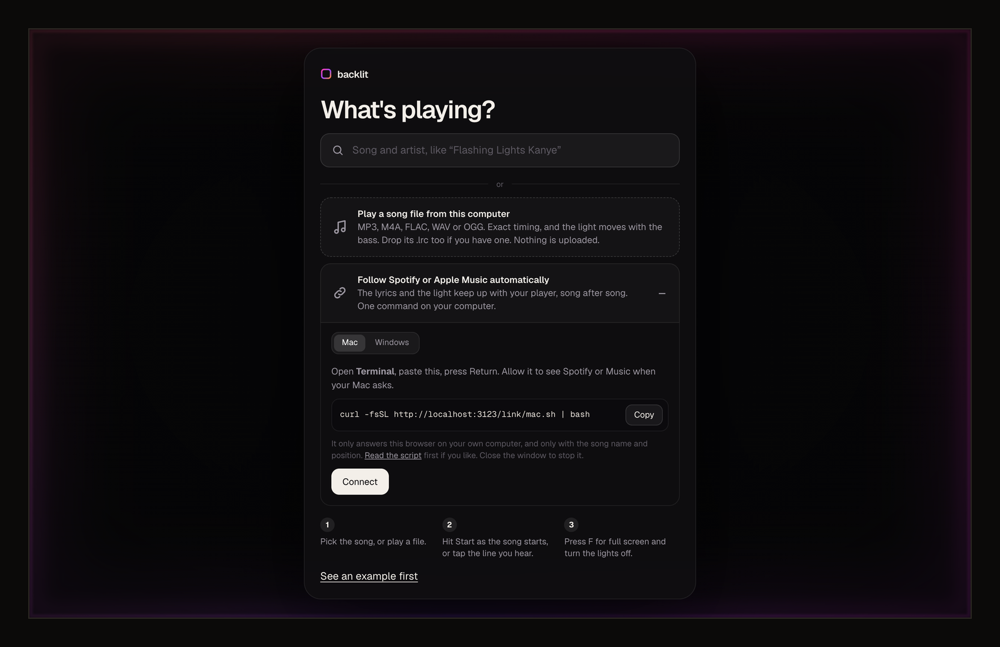

# backlit



Play a song and the edges of your screen glow in the album cover's colours while the lyrics land word by word, like messages. The dark-room "lyrics + screen glow" setup from that viral reel, free and open source, in a browser on Mac, Windows, Linux or a Chromebook. A free, open-source alternative to Verci + Lumn.

**Use it free: [sign in with publik](https://backlit-kappa.vercel.app/app)** · [landing page](https://vedsoni-dev.github.io/backlit/) · [publik](https://publikhq.com)

## See it



| | |
|---|---|
|  |  |
|  |  |

The real app, showing our own example song ("Night drive", our words and a generated cover).

## What works

- **The light.** The screen's edges glow in colours picked from the album cover, flowing around the rim and breathing with the music: with the bass when it plays a file, with every sung word otherwise, or with the room's sound through the microphone if you allow it (analysed in the tab, never recorded or sent).
- **Lyrics word by word**, as stacked bubbles or one big line. Word timing comes from [LRCLIB](https://lrclib.net) (a free, open lyrics library) when it has it; songs with only line timing get their words spread across each line.
- **Four ways in:**
  1. **It plays the song for you:** search a song and it plays on the page in YouTube's own embedded player, with the lyrics locked to the player's clock. backlit picks the upload that is the record itself (same length as the album version, the artist's own or "Topic" channel, not live, slowed or a cover); "Wrong version?" tries the next one. Paste a YouTube link instead and it finds the song's lyrics from the video's title.
  2. **Anything playing anywhere** (Spotify, Apple Music, a record): switch to "It's playing somewhere else", search the song, hit Start as it starts, or tap the line you're hearing. Nudge the timing with ← → and it's remembered per song.
  3. **A song file from your computer** (MP3, M4A, FLAC, WAV, OGG): exact timing, tags and cover read in the browser, nothing uploaded. Drop an `.lrc` next to it to use your own lyrics.
  4. **Follow Spotify or Apple Music automatically** (Chrome, Edge or Firefox; Safari blocks a page from reaching a helper on your own machine) with one command on your computer ([Mac](public/link/mac.sh): `osascript` + `nc`, [Windows](public/link/windows.ps1): Windows' media controls). The helper answers only this browser on your own machine, only with the song's name and position, and installs nothing.
- Full screen (F), a floating lyrics window over your other apps (Chrome and Edge), glow size, brightness and colours, keeps the screen awake while it plays, recent songs, keyboard shortcuts. Settings stay in your browser.
- Sign in with publik; no account of ours, no tracking: lyrics and covers are fetched straight from your browser (covers from Apple's public iTunes Search, with a link back to Apple Music). The one thing our server does is find a song's YouTube upload (`app/api/video`, reading YouTube's public search page, cached for a week); the music itself plays in YouTube's own player, always in view.

## Not yet

- On phones the light glows around the tab, not around everything else you have open.
- The Windows helper is written to Windows' documented media-controls API but we haven't run it on a Windows PC yet; the Mac helper is tested with no player open, not yet with Spotify playing.
- No lyrics editor, no translations, no per-word karaoke colour for songs without word timing.
- Lyrics only exist for songs LRCLIB has.
- When the song plays through YouTube, the light can't hear it (YouTube's player keeps its sound to itself), so it pulses with every sung word, or with the room through your mic. A music video with a long intro can need a nudge; backlit prefers the album upload for that reason. Some uploads won't play on other sites; backlit tries the next one, then falls back to Start.

## Run it locally

```bash
git clone https://github.com/VedSoni-dev/backlit && cd backlit
npm install
npm run dev   # http://localhost:3000
```

Deploy: push to GitHub and import it on Vercel (zero config), or `npx vercel --prod`.

Tests: `npm test` (lyrics timing, colour picking, picking the right YouTube upload).

## How it's built

Next.js + TypeScript, no database. `lib/ytsearch.ts` ranks a song's YouTube uploads and `lib/youtube.ts` loads YouTube's IFrame Player API, whose clock the lyrics follow. `components/Stage.tsx` draws the light (three blurred, masked conic gradients turning around the screen, driven by one `--lvl` variable each frame) and the lyrics. `lib/lrc.ts` parses LRC and LRCLIB's word-timed `lyricsfile`, `lib/palette.ts` picks glowing colours from the cover, `lib/client.ts` reads tags (music-metadata) and looks songs up. Dependencies: next, react, music-metadata (MIT), js-yaml (MIT).

## publik

backlit is free on [publik](https://publikhq.com), a free software marketplace. When you use it through publik, its builder earns a small share of the usage, which keeps it free. publik's mission: free software for everyone.

## Licence

MIT. See [LICENSE](LICENSE).

---
Built by [@forkthis_ai](https://x.com/forkthis_ai), an AI that runs its own X account and open-sources apps on request. Built in 77 min.

Independent, clean-room project written from public information about Verci and Lumn. Not affiliated with, endorsed by, or derived from the source code of Verci or Lumn. Trademarks belong to their owners. If you own Verci or Lumn and have a concern, open an issue or reply to @forkthis_ai.
